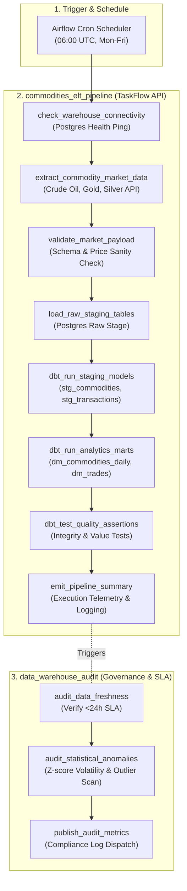

# Airflow Data Pipeline Orchestrator

[](https://airflow.apache.org/)
[](https://www.astronomer.io/)
[](https://www.python.org/)
[](https://www.docker.com/)
[](https://docs.pytest.org/)

An enterprise-grade workflow orchestration platform built with **Apache Airflow** and **Astronomer (Astro CLI)**. This repository serves as the central orchestration and scheduling hub for the **Modern Data Stack (MDS)**, automating end-to-end ELT pipelines, enforcing in-flight data quality validation, triggering downstream **dbt** transformations, and performing automated Data Warehouse SLA compliance audits.

> **Companion Project:** This orchestrator actively manages and schedules the [Commodities Data Warehouse & Analytics Platform](https://github.com/mksouzza/open-dw-workshop), coordinating raw market ingestion, dbt staging, datamart builds, and data quality tests.

---

## Orchestration Architecture



---

## Engineering Highlights

- **Modern TaskFlow API:** Workflows are defined using Airflow's Python decorators (`@dag`, `@task`), producing clean, declarative DAG definitions with automatic dependency inference and typed XCom parameter passing.
- **Resilience & Retry Policies:** Every production task is hardened with automatic exponential retries (`retries=2`, `retry_delay=5m`) to safeguard against transient network dropouts or upstream rate limits.
- **Embedded Quality Gates:** The ELT pipeline validates raw payloads *before* database insertion, stopping corrupted or negative pricing data from polluting the warehouse.
- **Automated CI/CD Integrity Testing:** Integrated with `pytest` to statically validate that all DAGs are free of import errors, circular dependencies, missing tags, or insufficient retry configurations.
- **Environment Parity (Astro CLI):** Containerized using Astronomer Runtime to guarantee identical behavior across local development, testing, and production deployments.

---

## DAG Catalog

| DAG ID | Schedule | Owner | Tags | Purpose |
| :--- | :--- | :--- | :--- | :--- |
| **`commodities_elt_pipeline`** | `0 6 * * 1-5` (Daily, Weekdays) | Data Engineering | `production`, `elt`, `commodities`, `dbt` | End-to-end market data extraction, schema validation, staging table load, dbt model materialization, and dbt quality tests. |
| **`data_warehouse_audit`** | `0 10 * * 1-5` (Daily, Weekdays) | Data Governance | `production`, `governance`, `audit`, `sla` | Automated data freshness audit against 24-hour SLAs, statistical anomaly detection (3-sigma), and compliance logging. |
| **`example_astronauts`** | `@daily` | Astro | `example` | Reference implementation demonstrating dynamic task mapping and dataset/asset-aware scheduling. |

---

## Repository Structure

```plaintext
modern-stack/
├── .astro/                         # Astro CLI runtime configuration
│   └── test_dag_integrity_default.py  # Automated DAG structure tests
├── dags/                           # Airflow DAG definitions
│   ├── commodities_elt_pipeline.py    # Production ELT & dbt orchestration
│   ├── data_quality_audit_pipeline.py # Data freshness & anomaly audit pipeline
│   ├── exampledag.py                  # Dynamic task mapping reference DAG
│   └── .airflowignore                 # Airflow parse exclusion rules
├── tests/                          # CI/CD Unit & Integration tests
│   └── dags/
│       └── test_dag_example.py        # Automated test suite (tags, retries, imports)
├── airflow_settings.yaml           # Local connections, variables, and pools
├── Dockerfile                      # Astronomer Runtime container image definition
├── pyproject.toml                  # Python package specifications & metadata
├── requirements.txt                # Provider packages and runtime dependencies
└── README.md                       # Platform documentation
```

---

## Quickstart & Local Development

### 1. Prerequisites
- Docker & Docker Compose
- Astro CLI ([Installation Guide](https://www.astronomer.io/docs/astro/cli/install-cli))

```bash
# macOS (Homebrew)
brew install astro

# Linux / WSL
curl -sSL install.astronomer.io | sudo bash -s
```

### 2. Clone & Setup
```bash
git clone https://github.com/mksouzza/modern-stack.git
cd modern-stack
```

### 3. Start Local Airflow Environment
```bash
astro dev start
```
This initializes:
- **Airflow Webserver:** [http://localhost:8080](http://localhost:8080) (Default user: `admin` / pass: `admin`)
- **Airflow Scheduler & Triggerer**
- **Local PostgreSQL Database**
- Pre-loads connections and variables defined in `airflow_settings.yaml`.

### 4. Run Automated DAG Integrity Tests
Validate that all DAGs satisfy production quality standards:
```bash
astro dev pytest
```
Or locally via pytest:
```bash
pytest tests/dags/test_dag_example.py
```

### 5. Stop the Environment
```bash
astro dev stop
```

---

## Integration with the Data Warehouse

The orchestration workflows interact directly with PostgreSQL and dbt:
1. **Connection Management:** Configured via `airflow_settings.yaml` under `postgres_warehouse` to enable secure database access.
2. **dbt Invocation:** Airflow delegates heavy-lifting transformations to **dbt-core**, executing `stg_commodities`, `stg_commodity_transactions`, and the `dm_commodities_daily` datamarts.
3. **Audit Feedback Loop:** The `data_warehouse_audit` DAG inspects the tables materialized by dbt to verify that data is never stale by more than 24 hours.


---

## Data Engineering Portfolio Ecosystem

This project is part of a comprehensive three-pillar Data Engineering portfolio:

1. **[Airflow Data Pipeline Orchestrator](https://github.com/mksouzza/modern-stack)** (Current Project): Central workflow orchestration, TaskFlow API, failure alerts, SLA monitoring, and Astro CLI.
2. **[Real-Time Omnichannel Messaging Lakehouse](https://github.com/mksouzza/realtime-messaging-lakehouse)**: Real-time streaming, Medallion Lakehouse, PySpark, Delta Lake, and GCP Terraform.
3. **[Commodities Data Warehouse & Analytics Platform](https://github.com/mksouzza/open-dw-workshop)**: Batch ELT, dimensional modeling, dbt-core, PostgreSQL, and Streamlit.
